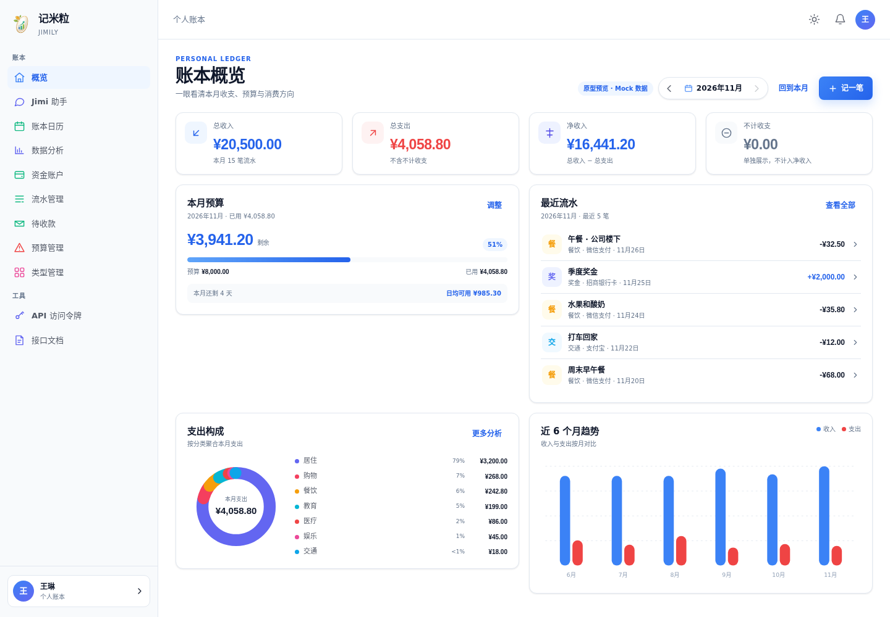
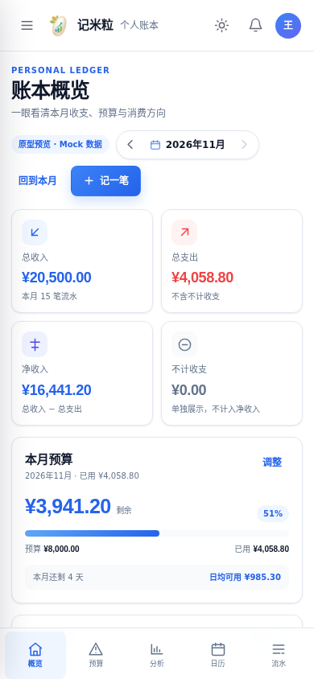
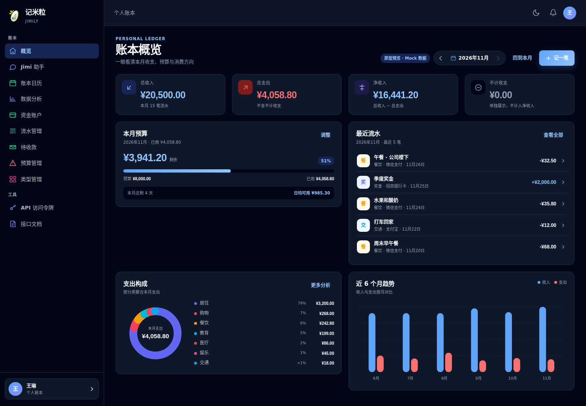
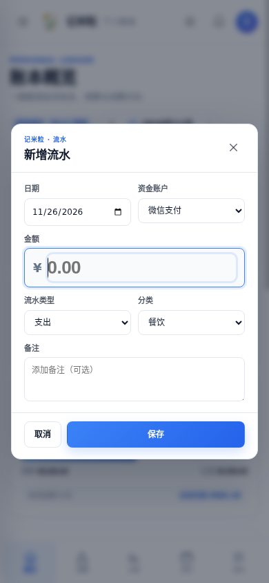

# Review Summary

- 本次需求: 在现有 Jimily（记米粒）Nuxt 4 全栈记账应用中新增「账本概览」页面与快速记账入口，统一展示本月收支、预算进度、最近流水、支出构成与近 6 个月趋势。
- 需求类型: UX / frontend change；复用现有 Backend/Data 与 API；NFR / DFX。
- 变更面: UX Design、Backend/Data（仅复用，无 schema 变更）、API Design（仅复用现有内部接口）、NFR/DFX、Traceability；不涉及: 新增数据库表/迁移、登录与权限体系改造、Jimi AI 工具、账单导入导出、现有流水/分析/预算/账户页面重构、站点/环境/版本差异；待确认: 根路由是否改为概览（默认不改）、移动端底栏 5 项布局、趋势图组件扩展方式。
- 变更面判断依据: 目标仓库 `wzzzzz/jimily` 的 `AGENTS.md`、`app/pages`、`app/components`、`server/api/entry`、`prisma/schema.prisma`、现有流水/分析/预算页面与 API。
- 差异判断: 产品形态为现有 Jimily Web 应用内的单页增量；不涉及站点差异、服务端环境差异与历史版本兼容；依据: 仓库现有 Nuxt 4 + PostgreSQL 架构与用户确认的目标仓库。
- 本次变更关键信息:
  - 新增 `/user/overview` 概览页，默认当前月，支持历史月份切换。
  - 新增侧栏与移动端底栏「概览」入口；移动端底栏由 4 项调整为 5 项。
  - 复用现有 `flow/page`、`analytics/industryType`、`analytics/month`、`budget/all` 接口，不新增后端聚合接口。
  - 复用现有 `FlowEditDialog` 完成快速记账，保存后刷新概览。
  - 不新增数据库表、字段、Prisma migration 或运行时依赖。
  - 重要风险/待确认点: 根路由是否改为概览、底栏 5 项在窄屏的可用性、趋势图是否扩展 `MonthBar`。
- Review 重点:
  - 概览页是否严格复用现有数据与组件，避免重复建设或新增接口。
  - 汇总、预算、最近流水、支出构成、趋势的口径是否与现有流水/分析/预算页面一致。
  - 空态、无预算、接口失败、加载中、长文本、窄屏与深色模式是否完整。
  - 是否遵守仓库 `AGENTS.md`：不新增表/迁移、不读 `.env`/`data/`、文档/设计/变更记录落位正确。

## Scope Note

- Implemented sections: Review Summary、Scope Note、Context、Goals and Non-Goals、Glossary、Functional Requirements、UX Design、Backend/Data、API Design、Metrics、NFR/DFX、Open Questions、Traceability、验收清单。
- Not involved: 新增数据库表/字段/迁移；登录、注册、JWT、密码哈希改造；Jimi AI 工具与对话链路；账单解析、CSV/JSON 导入导出；流水、分析、预算、账户、分类页面的重构；站点差异、服务端环境差异、历史版本兼容。
- Needs confirmation: 根路由 `/` 是否改为 `/user/overview`（默认保留 `/user/jimi`）；移动端底栏 5 项的最终排列；趋势图复用 `MonthBar` 还是页面内渲染。
- Reason: 目标仓库已具备完整记账能力，本次为现有 Nuxt 应用内的概览页增量，变更集中在前端页面与导航，不涉及数据模型与后端契约变更。

# PRD 文档: 记米粒 — 账本概览（个人记账项目雏形）

## 1. Context

### 1.1 需求来源

用户希望在其个人记账项目 `wzzzzz/jimily` 中交付「个人记账项目雏形」。目标仓库是 Jimily / 记米粒 `5.1.6`：Nuxt 4 + Vue 3 + PostgreSQL + Prisma 的个人记账应用，已具备登录、流水、资金账户、预算、分析、分类、日历、借出、API 令牌与 AI 助手 Jimi。

仓库 `AGENTS.md` 要求：定制开发沿现有 Nuxt 全栈结构扩展，不另起前端或后端框架；不新建/编辑/执行 Prisma migration；文档放 `docs/`，设计方案放 `design/`，代码/脚本变更记录放 `changelog/`。

### 1.2 当前问题与机会

| 现状 | 问题 | 机会 |
| --- | --- | --- |
| 根路由 `/` 跳转 `/user/jimi` | 没有默认的账本概览页，用户先看到 AI 对话 | 新增 `/user/overview`，通过侧栏/底栏进入 |
| 流水在 `/user/flows`、分析在 `/user/analysis`、预算在 `/user/budget` | 用户需跨页拼凑「本月花了多少、还剩多少预算、最近记了什么」 | 在一个页面聚合汇总、预算、最近流水、构成与趋势 |
| 现有 `FlowEditDialog` 已支持新增/编辑流水 | 概览页缺少快速记账入口 | 复用现有弹窗，不新建表单 |
| 现有 API 已返回月度汇总、分类聚合、月度趋势、预算 | 无需新增后端接口 | 页面并行调用现有接口，降低改动面 |

### 1.3 用户角色

| 角色 | 场景 | 期望结果 |
| --- | --- | --- |
| 已登录 Jimily 个人用户 | 打开应用后快速了解本月账本 | 一屏看到本月收入、支出、净收入、预算进度、最近流水、支出构成与趋势 |
| 已登录 Jimily 个人用户 | 想起一笔消费，立即记录 | 从概览页打开现有流水弹窗，保存后概览即时更新 |
| 已登录 Jimily 个人用户 | 发现某条流水分类/金额有误 | 点击最近流水打开现有编辑弹窗，修改后概览刷新 |

### 1.4 交付上下文

| 项 | 值 |
| --- | --- |
| 远程仓库 | `https://github.com/wzzzzz/jimily` |
| 基线分支 | `main`（commit `98487d6`） |
| 工作分支 | `feat/personal-ledger-prototype` |
| 影响目录 | `app/pages/user/overview.client.vue`（新增）、`app/components/layout/AppSidebar.vue`、`app/components/layout/AppBottomNav.vue`、`docs/`、`design/`、`changelog/` |
| 设计系统 | 沿用现有 Tailwind 语义色与默认白蓝主题（`app/utils/theme-presets.ts`），不新增独立设计系统 |
| 禁止改动 | `.env`、`data/`、`prisma/migrations/**`、数据库备份、账单样例 |

## 2. Goals and Non-Goals

### 2.1 Goals

| 目标 | 衡量方式 | 目标值 / 判断标准 |
| --- | --- | --- |
| G-01 统一本月概览 | 概览页首屏信息完整度 | 375px 宽度下首屏可见汇总、预算、最近流水入口，无横向滚动 |
| G-02 快速记账 | 从概览页点击到保存成功 | 不超过 3 个主要步骤；保存后汇总与最近流水在 1 次刷新内更新 |
| G-03 复用现有能力 | 新增后端接口/表/迁移数量 | 0 个新增表、0 个新增迁移、0 个新增后端聚合接口 |
| G-04 导航可达 | 从其他页面进入概览 | 侧栏或移动端底栏 1 次点击可达 |
| G-05 体验一致 | 组件与主题 | 复用现有语义色、卡片、弹窗、Toast、ECharts/Heroicons，无新配色体系 |

### 2.2 Non-Goals

- 不新建数据库表、字段或 Prisma migration；不改 `prisma/schema.prisma`。
- 不改造登录、注册、JWT、用户隔离、密码哈希。
- 不新增 localStorage 单用户形态、独立后端或独立前端框架。
- 不重做流水、分析、预算、账户、分类页面。
- 不改变根路由 `/` → `/user/jimi`（本迭代默认保留）。
- 不新增或修改 Jimi 工具、账单解析、CSV/JSON 导入导出。
- 不新增图表库、UI 组件库或第三方依赖。
- 不改变现有接口契约、OpenAPI 与数据模型。

## 3. Glossary

| 术语 | 定义 |
| --- | --- |
| 流水 / Flow | 一条收入、支出或不计收支记录；字段见 `Flow` 模型（`day`、`flowType`、`industryType`、`money`、`accountId`、`name`、`description`、`attribution` 等）。 |
| 资金账户 / FundAccount | 银行卡、信用卡、微信、支付宝、投资账户等；余额由流水重算。 |
| 预算 / Budget | 按 `YYYY-MM` 的月度预算，含 `budget` 与 `used`。 |
| 分类 / industryType | 流水的支出类型或收入类型，如餐饮、交通、工资。 |
| 归属 / attribution | 流水的归属人/来源说明。 |
| 净收入 | 总收入 − 总支出；不计收支不参与净收入计算。 |
| 不计收支 | `flowType = 不计收支` 的记录，单独展示。 |
| Jimi | 现有 AI 助手，本次不修改其工具与对话链路。 |

## 4. Functional Requirements

### REQ-001: 概览页与访问控制

- **User Story**: As a 已登录 Jimily 用户, I want 从侧栏或底栏进入账本概览, so that 我能快速了解本月账本状态。
- **Priority**: P0
- **Description**: 新增 `/user/overview` 页面，使用现有 `public` 布局与 `auth` 中间件；未登录用户按现有逻辑跳转登录。

**Acceptance Requirements (EARS):**

- REQ-001.1: When 已登录用户访问 `/user/overview`, the system shall 渲染概览页并加载当前月份数据。
- REQ-001.2: If 用户未登录或 JWT 失效, then the system shall 按现有 `auth` 中间件与 `doApi` 逻辑跳转登录，不展示其他用户数据。
- REQ-001.3: The system shall 在页面中使用现有 `public` 布局（侧栏、顶栏、移动端底栏），不新增独立布局。

**Gherkin:**

```gherkin
Scenario: 登录用户进入概览
  Given 用户已登录 Jimily
  When 用户访问 /user/overview
  Then 页面展示当前月份的汇总、预算、最近流水、支出构成与趋势
  And 侧栏或底栏的「概览」处于选中态
```

### REQ-002: 月份切换

- **User Story**: As a 个人用户, I want 切换月份查看历史账本, so that 我能回顾过去几个月的收支。
- **Priority**: P0
- **Description**: 概览页提供月份切换控件，默认当前月；可查看历史月份；不可进入未来月份；提供「回到本月」。

**Acceptance Requirements (EARS):**

- REQ-002.1: When 页面首次加载, the system shall 默认选中当前月份（本地时区 `YYYY-MM`）。
- REQ-002.2: When 用户点击上一月, the system shall 将月份减 1，并重新加载汇总、预算、最近流水、支出构成与趋势。
- REQ-002.3: When 用户点击下一月, the system shall 在目标月份不晚于当前月时切换；否则禁用或忽略。
- REQ-002.4: When 用户点击「回到本月」, the system shall 恢复当前月份。
- REQ-002.5: The system shall 在月份切换期间展示加载态，避免旧数据与新月份标签不一致。

### REQ-003: 本月汇总卡

- **User Story**: As a 个人用户, I want 一眼看到本月收入、支出与净收入, so that 我能判断本月财务状态。
- **Priority**: P0
- **Description**: 概览页顶部展示总收入、总支出、净收入、不计收支四项汇总，数据来自 `POST /api/entry/flow/page` 返回的 `totalIn`、`totalOut`、`notInOut`。

**Acceptance Requirements (EARS):**

- REQ-003.1: The system shall 展示总收入、总支出、净收入、不计收支四项；金额保留两位小数。
- REQ-003.2: The system shall 按 `净收入 = 总收入 − 总支出` 计算净收入；不计收支不参与计算。
- REQ-003.3: When 某月无流水, the system shall 展示 0.00，并提供「记一笔」入口。
- REQ-003.4: The system shall 使用现有 `FlowsStatistics` 组件的视觉与文案风格，保持与流水页一致。
- REQ-003.5: If 汇总接口失败, then the system shall 展示区块级错误/空态，不影响其他区块。

### REQ-004: 预算进度

- **User Story**: As a 个人用户, I want 看到本月预算使用进度, so that 我能控制消费节奏。
- **Priority**: P1
- **Description**: 读取 `POST /api/entry/budget/all`，匹配所选月份 `Budget.month`，展示预算、已用、剩余与进度条。

**Acceptance Requirements (EARS):**

- REQ-004.1: When 所选月份存在预算, the system shall 展示预算金额、已用金额、剩余金额与进度条。
- REQ-004.2: The system shall 按 `used / budget` 计算进度；`budget` 为空或 0 时显示「未设置预算」。
- REQ-004.3: When 已用超过预算, the system shall 以警示色展示超支金额与进度。
- REQ-004.4: When 所选月份无预算, the system shall 展示「未设置预算」与「去设置」入口，链接到 `/user/budget`。
- REQ-004.5: If 预算接口失败, then the system shall 展示区块级提示，不影响其他区块。

### REQ-005: 最近流水

- **User Story**: As a 个人用户, I want 看到本月最近几笔流水, so that 我能确认最近记录是否正确。
- **Priority**: P0
- **Description**: 展示所选月份最近 5 条流水，按 `day` 倒序、`id` 倒序；点击某条打开现有 `FlowEditDialog` 编辑；提供「查看全部」链接到 `/user/flows`。

**Acceptance Requirements (EARS):**

- REQ-005.1: The system shall 展示最近 5 条流水的日期、名称/分类、资金账户与金额。
- REQ-005.2: When 用户点击某条流水, the system shall 打开现有 `FlowEditDialog`，回填该流水并允许编辑。
- REQ-005.3: When 编辑保存成功, the system shall 关闭弹窗、显示现有成功提示，并重新加载概览。
- REQ-005.4: When 所选月份无流水, the system shall 展示空态与「记一笔」入口。
- REQ-005.5: The system shall 对超长名称/分类/账户使用省略展示，金额右对齐。

### REQ-006: 支出构成

- **User Story**: As a 个人用户, I want 看到本月支出分类构成, so that 我能发现主要消费方向。
- **Priority**: P1
- **Description**: 调用 `POST /api/entry/analytics/industryType`（`flowType = 支出`，所选月份起止日期），按 `outSum` 降序展示前 6 类与占比。

**Acceptance Requirements (EARS):**

- REQ-006.1: The system shall 按分类展示本月支出金额与占比，最多展示前 6 类。
- REQ-006.2: The system shall 以图表或条形列表展示构成，颜色使用现有主题色/图表配色。
- REQ-006.3: When 本月无支出, the system shall 展示「本月暂无支出」空态。
- REQ-006.4: If 分类接口失败, then the system shall 展示区块级错误/空态，不影响其他区块。
- REQ-006.5: The system shall 不展示其他用户的分类数据；请求由 JWT 自动隔离。

### REQ-007: 近 6 个月趋势

- **User Story**: As a 个人用户, I want 看到近 6 个月收入/支出趋势, so that 我能判断消费变化。
- **Priority**: P1
- **Description**: 调用 `POST /api/entry/analytics/month`，展示以所选月份为终点的近 6 个月收入/支出柱状趋势。

**Acceptance Requirements (EARS):**

- REQ-007.1: The system shall 展示近 6 个月的收入与支出，按月份升序排列。
- REQ-007.2: The system shall 使用现有 ECharts 能力或现有 `MonthBar` 组件，不新增图表库。
- REQ-007.3: When 近 6 个月无数据, the system shall 展示空态。
- REQ-007.4: When 用户切换月份, the system shall 将趋势终点同步到所选月份。
- REQ-007.5: If 趋势接口失败, then the system shall 展示区块级错误/空态，不影响其他区块。

### REQ-008: 快速记账

- **User Story**: As a 个人用户, I want 从概览页直接记一笔, so that 我不需要先进入流水页。
- **Priority**: P0
- **Description**: 概览页提供「记一笔」主按钮，复用现有 `FlowEditDialog`；保存成功后刷新概览。

**Acceptance Requirements (EARS):**

- REQ-008.1: When 用户点击「记一笔」, the system shall 打开现有 `FlowEditDialog`，标题为「新增流水」，默认日期为今天。
- REQ-008.2: When 用户在弹窗中保存成功, the system shall 使用现有 `Alert.success` 提示，并重新加载概览。
- REQ-008.3: If 用户取消弹窗, then the system shall 不新增流水，概览数据保持不变。
- REQ-008.4: The system shall 复用现有表单校验、账户选择、分类联动与保存逻辑，不新建表单或接口。
- REQ-008.5: The system shall 在弹窗打开时保持概览页滚动位置与数据，不整页刷新。

### REQ-009: 导航入口

- **User Story**: As a 个人用户, I want 在侧栏和手机底栏都能进入概览, so that 我能快速访问。
- **Priority**: P0
- **Description**: 在 `AppSidebar.vue` 的用户菜单与 `AppBottomNav.vue` 的移动端底栏新增「概览」入口，指向 `/user/overview`；当前路径时展示选中态。

**Acceptance Requirements (EARS):**

- REQ-009.1: The system shall 在侧栏用户菜单中新增「概览」，建议置于「Jimi 助手」之前或之后，保持现有视觉风格。
- REQ-009.2: The system shall 在移动端底栏新增「概览」，底栏由 4 项调整为 5 项，图标使用现有 Heroicons 风格。
- REQ-009.3: When 当前路径为 `/user/overview`, the system shall 在侧栏与底栏展示选中态。
- REQ-009.4: The system shall 不改变其他菜单项的路径、顺序与权限逻辑。
- REQ-009.5: The system shall 在窄屏（< 1024px）下保证 5 项底栏不重叠、不被内容遮挡。

### REQ-010: 加载、空态、异常与响应式

- **User Story**: As a 个人用户, I want 页面在慢网、无数据和手机上都可用, so that 我不会因为加载或布局问题无法记账。
- **Priority**: P1
- **Description**: 概览页覆盖加载、空态、接口失败、长文本、窄屏与深色模式。

**Acceptance Requirements (EARS):**

- REQ-010.1: When 页面加载数据, the system shall 展示轻量加载态或骨架，避免布局抖动。
- REQ-010.2: If 单个接口失败, then the system shall 展示该区块的空态/错误提示，不影响其他区块；使用现有 Toast 或区块提示。
- REQ-010.3: The system shall 在 375px–1440px 宽度范围内无横向滚动；移动端卡片单列，桌面端双列。
- REQ-010.4: The system shall 沿用现有 Tailwind 语义色与深色模式变量，不写死颜色。
- REQ-010.5: The system shall 为交互元素提供可见焦点、可读标签与足够的对比度；弹窗与按钮支持键盘操作。
- REQ-010.6: The system shall 在深色模式下保持图表、卡片、文字与进度条可读。

## 5. UX Design

### 5.1 体验目标与设计原则

- **一屏回答六个问题**：本月收入、支出、净收入、预算、最近流水、支出构成。
- **复用优先**：沿用现有卡片、汇总组件、流水弹窗、Toast、ECharts 与语义色，降低学习成本。
- **快速行动**：概览页顶部提供「记一笔」，最近流水可点击编辑。
- **克制**：不新增配色体系，不堆叠次要指标；账户余额等留到后续。

### 5.2 页面 / 模块 / 入口范围

| 模块 | 入口 | 核心内容 | 关联 REQ |
| --- | --- | --- | --- |
| 概览页 | `/user/overview` | 月份切换、汇总卡、预算进度、最近流水、支出构成、近 6 个月趋势、记一笔 | REQ-001～008 |
| 侧栏入口 | `AppSidebar.vue` | 「概览」菜单项 | REQ-009 |
| 移动端底栏 | `AppBottomNav.vue` | 「概览」底栏项（5 项之一） | REQ-009 |
| 快速记账 | 概览页「记一笔」 | 复用 `FlowEditDialog` | REQ-008 |

### 5.3 核心体验路径

1. 登录 → 侧栏/底栏点击「概览」。
2. 默认当前月，看到汇总卡、预算进度、最近流水、支出构成与趋势。
3. 点击「记一笔」→ 在现有流水弹窗填写 → 保存 → 概览刷新。
4. 点击最近流水 → 编辑 → 保存 → 概览刷新。
5. 点击「查看全部」「数据分析」「预算管理」进入现有页面。

### 5.4 页面结构

**顶部区域**

- 标题「账本概览」+ 当前月份标签。
- 月份切换：上一月 / 当前月份 / 下一月 / 回到本月。
- 主按钮「记一笔」。
- 可选的日期/问候语，保持简洁。

**汇总区**

- 四项汇总卡：总收入、总支出、净收入、不计收支。
- 复用 `FlowsStatistics` 的视觉：小标签 + 大金额 + 图标；桌面 4 列，移动端 2×2。
- 收入/净收入使用主色（`text-primary-600`），支出使用红色（`text-red-500`），不计收支使用 `text-foreground/70`。

**主体网格**

- 桌面：左侧「最近流水」+「支出构成」，右侧「预算进度」+「近 6 个月趋势」；或 2 列自适应。
- 移动：单列，顺序为预算 → 最近流水 → 支出构成 → 趋势。
- 卡片使用 `bg-surface`、`border border-border`、`rounded-lg`、`shadow-soft`（如现有页面）。

**最近流水**

- 列表行：日期、分类/名称、资金账户、金额、编辑箭头。
- 最多 5 条；点击打开 `FlowEditDialog`。
- 右上角「查看全部」→ `/user/flows`。

**预算进度**

- 预算金额、已用、剩余、进度条。
- 超支时使用红色提示。
- 无预算时展示「未设置预算」与「去设置」→ `/user/budget`。

**支出构成**

- 环形图或横向条形列表，展示前 6 类与占比。
- 颜色使用现有主题色/图表配色；图例可点击（可选，沿用现有图表交互）。
- 无支出时展示空态。

**近 6 个月趋势**

- 收入/支出双柱状图，月份升序，终点为所选月份。
- 复用 `MonthBar` 或页面内 ECharts 配置；不新增图表库。

### 5.5 分支路径与异常路径

| 场景 | 用户可见结果 |
| --- | --- |
| 本月无流水 | 汇总为 0.00；最近流水空态；支出构成空态；趋势展示历史数据 |
| 无预算 | 预算卡展示「未设置预算」+「去设置」 |
| 预算超支 | 进度条满格/警示色，显示超支金额 |
| 单个接口失败 | 该区块展示错误/空态，其他区块正常；Toast 提示 |
| 快速记账取消 | 弹窗关闭，概览数据不变 |
| 快速记账保存失败 | 保留弹窗内容，现有 Toast 提示错误，可重试 |
| 长文本 | 名称/分类/账户省略，金额右对齐 |
| 深色模式 | 语义色自动适配，图表文字与网格保持可读 |

### 5.6 关键文案

| 位置 | 文案 |
| --- | --- |
| 页面标题 | 账本概览 |
| 汇总 | 总收入 / 总支出 / 净收入 / 不计收支 |
| 预算 | 本月预算 / 已用 / 剩余 / 未设置预算 / 去设置 |
| 最近流水 | 最近流水 / 查看全部 / 暂无流水 |
| 支出构成 | 支出构成 / 本月暂无支出 |
| 趋势 | 近 6 个月趋势 / 暂无趋势数据 |
| 主按钮 | 记一笔 |
| 月份 | 回到本月 |
| 空态引导 | 记下本月第一笔 |

### 5.7 视觉与响应式约束

- 主题：沿用 `app/utils/theme-presets.ts` 的默认白蓝主题；主色 `primary-500/600`（蓝），辅助色 slate，强调色 indigo；不写死新配色。
- 布局：沿用 `app/layouts/public.vue` 的顶栏（64px）、侧栏（256px）、移动端底栏；页面内容使用 `p-2 md:p-4` 与卡片网格。
- 卡片：`bg-surface`、`border border-border`、`rounded-lg`、`shadow-soft`；与流水页、分析页一致。
- 图表：ECharts + `nuxt-echarts`；颜色使用现有主题/图表配置。
- 响应式：移动端单列，桌面端 2 列；底栏 5 项在 375px 下不重叠。
- 深色模式：沿用 `dark:` 类与 CSS 变量，不新增独立深色配色。
- 可访问性：焦点可见、按钮有标签、图表有标题/图例、颜色不作为唯一信息载体。

### 5.8 原型参考

静态原型位于 `design/personal-ledger-overview/index.html`，使用现有白蓝主题与 Mock 数据，覆盖：

- 桌面端概览（侧栏 + 汇总 + 预算 + 最近流水 + 支出构成 + 趋势）。
- 移动端概览（底栏 5 项 + 单列卡片）。
- 快速记账弹窗（复用现有流水弹窗的字段与视觉）。
- 深色模式切换。

桌面端概览：



移动端概览：



深色模式：



快速记账弹窗：



## 6. Backend/Data

### 6.1 数据模型（复用，不修改）

| 模型 | 本次使用字段 | 说明 |
| --- | --- | --- |
| `Flow` | `id`、`day`、`flowType`、`industryType`、`money`、`accountId`、`name`、`description`、`attribution` | 流水；本次只读与新增/编辑复用现有接口 |
| `FundAccount` | `id`、`name`、`currentBalance`、`status` | 账户名称用于最近流水展示；余额卡不纳入首版 |
| `Budget` | `month`、`budget`、`used` | 预算进度 |
| `User` | 当前登录用户 | 由 JWT 解析，不在页面传递 `userId` |

**本次不新增/修改任何表、字段、索引或 migration。**

### 6.2 复用接口

| 接口 | 方法 | 用途 | 关键字段 |
| --- | --- | --- | --- |
| `/api/entry/flow/page` | POST | 本月最近 5 条流水 + 汇总 | 请求：`startDay`、`endDay`、`pageNum=1`、`pageSize=5`；响应：`data`、`total`、`totalIn`、`totalOut`、`notInOut` |
| `/api/entry/analytics/industryType` | POST | 支出构成 | 请求：`flowType=支出`、`startDay`、`endDay`；响应：`[{ type, inSum, outSum, zeroSum }]` |
| `/api/entry/analytics/month` | POST | 近 6 个月趋势 | 请求：`startDay`、`endDay`；响应：`[{ type: "YYYY-MM", inSum, outSum, zeroSum }]` |
| `/api/entry/budget/all` | POST | 预算进度 | 响应：`[{ month, budget, used }]` |
| `/api/entry/flow/add` / `flow/update` | POST | 快速记账/编辑（由 `FlowEditDialog` 内部调用） | 现有字段与校验，不改契约 |

### 6.3 权限与隔离

- 所有接口通过现有 `server/middleware/auth.ts` 校验 JWT。
- 服务端从 JWT 取 `userId`，请求体中的 `userId` 不可信。
- 查询与写入均带当前 `userId` 约束；概览页不额外传递用户标识。
- 页面使用 `middleware: ["auth"]`，未登录按现有逻辑跳转。

### 6.4 失败处理与幂等

- 页面并行请求各区块数据；单个接口失败只影响该区块。
- 快速记账复用现有 `flow/add` 的校验与保存逻辑；重复提交由现有表单交互约束。
- 预算缺失、流水为空、分类为空均为正常空态，不作为错误。
- 日期边界沿用现有 `parseDateBoundary`，前端传入 `YYYY-MM-DD`。

### 6.5 迁移与兼容

- 不新增表/字段/迁移；无需数据迁移、回填或兼容分支。
- 现有流水、分析、预算、账户页面与接口保持不变。
- 新增页面与导航入口为纯前端增量，可独立回滚。

## 7. API Design

本需求不新增或修改对外 API、SDK、Webhook 或 CLI 契约；仅复用现有内部 `/api/entry/*` 接口。现有 OpenAPI（`public/openapi.json`）无需变更。

后续如需新增后端聚合接口（例如一次性返回概览所有区块），应另行设计接口契约、缓存与性能方案；不在本次范围。

## 8. Metrics

本需求不新增埋点、日志或 Dashboard 指标。现有应用未提供统一前端埋点链路；本次以现有服务端日志与页面可用性为主。

如后续需要评估概览页使用情况，可另行设计事件（如概览访问、快速记账入口点击、区块跳转），但需先确认现有埋点规范与隐私要求；不在本次范围。

## 9. NFR / DFX

| 类别 | 要求 | 验收方法 |
| --- | --- | --- |
| 性能 | 概览首屏在中等移动设备/4G 下 2 秒内可见；区块请求并行；避免重复请求 | Lighthouse/Performance 面板；网络面板检查请求数 |
| 兼容性 | 支持现有 Jimily 支持的浏览器与移动端；375px–1440px 无横向滚动；深色模式可用 | 手动浏览器矩阵；窄屏/深色模式走查 |
| 安全与隐私 | 复用现有 JWT、用户隔离；不读取/展示 `.env`、`data/`、密钥；不在前端传递 `userId` | 代码审查；接口鉴权检查 |
| 可用性 | 单区块失败不影响整页；空态/加载态清晰；快速记账失败可重试 | 手动异常注入；接口 mock |
| 可访问性 | 键盘可达、焦点可见、按钮有标签、图表有标题/图例、对比度达标 | 键盘走查；对比度检查；axe/Lighthouse |
| 可维护性 | 复用现有页面/组件/接口模式；不新增依赖；TypeScript 类型清晰 | 代码审查；`pnpm build`（由开发节点执行） |
| 发布与回滚 | 纯前端增量；新增页面与导航入口可独立回滚；不影响现有路由 | 部署后回滚演练；路由检查 |
| 站点 / 环境 / 版本差异 | 不涉及站点差异、服务端环境差异与历史版本兼容 | 需求与仓库证据 |
| 数据变更 | 无表/字段/迁移；无数据回填 | `prisma/schema.prisma` 与 `prisma/migrations` 检查 |

## 10. Open Questions

| ID | 问题 | 影响 | 建议负责人 |
| --- | --- | --- | --- |
| OQ-001 | 根路由 `/` 是否改为 `/user/overview`？ | 影响用户首次落地页与 Jimi 的使用频率；默认保留 `/user/jimi`，概览通过导航进入 | 产品 / 用户 |
| OQ-002 | 移动端底栏 5 项是否可接受，或替换现有某项？ | 影响窄屏可用性与导航习惯；默认新增「概览」为第 1 项，底栏 5 项 | 产品 / 用户 |
| OQ-003 | 趋势图复用 `MonthBar` 还是页面内渲染 6 个月数据？ | 影响改动范围与视觉一致性；默认优先复用 `MonthBar`，必要时页面内渲染 | 研发 |

## 11. Traceability

| REQ ID | UX / Data 对应 | API | NFR | QA 重点 |
| --- | --- | --- | --- | --- |
| REQ-001 | 概览页路由、布局、鉴权 | 现有 `auth` 中间件 | 安全、兼容性 | 未登录跳转；布局一致 |
| REQ-002 | 月份切换 | `flow/page`、`analytics/industryType`、`analytics/month`、`budget/all` | 性能、可用性 | 当前月/历史月/未来月/回到本月 |
| REQ-003 | 汇总卡 | `flow/page` 的 `totalIn/totalOut/notInOut` | 性能、可访问性 | 金额口径、空数据、接口失败 |
| REQ-004 | 预算进度 | `budget/all` | 可用性 | 有预算/无预算/超支/除零 |
| REQ-005 | 最近流水 | `flow/page`、`FlowEditDialog`、`flow/update` | 可用性、可访问性 | 5 条上限、编辑回填、保存刷新 |
| REQ-006 | 支出构成 | `analytics/industryType` | 性能、可访问性 | 前 6 类、占比、空态、颜色 |
| REQ-007 | 近 6 个月趋势 | `analytics/month` | 性能、可访问性 | 月份范围、空态、终点月份 |
| REQ-008 | 快速记账 | `FlowEditDialog`、`flow/add` | 可用性、安全 | 打开/取消/保存/失败重试 |
| REQ-009 | 侧栏/底栏入口 | 无 | 兼容性、可访问性 | 选中态、5 项布局、其他菜单不变 |
| REQ-010 | 加载/空态/异常/响应式 | 无 | 性能、可用性、可访问性 | 单区块失败、长文本、深色模式、窄屏 |

## 12. 验收清单

- [x] 核心场景已覆盖：进入概览 → 查看汇总/预算/最近流水/构成/趋势 → 快速记账 → 刷新。
- [x] 每条功能需求都有可验证的 EARS / Gherkin。
- [x] 非目标、兼容性、风险与回滚已说明。
- [x] 功能性需求与非功能性需求均已覆盖。
- [x] 明确不新增数据库表、字段、migration 或运行时依赖。
- [x] 明确复用现有接口、组件、主题与导航结构。
- [x] 待确认项已标记为 Open Questions，不阻塞原型评审。
- [x] 已提供静态原型与参考 Nuxt 页面（`design/personal-ledger-overview/`）。
- [x] 已提供 HTML 可读版本 `docs/PRD 文档.html`。
- [x] 已提供变更记录 `changelog/001-personal-ledger-overview.md`。
